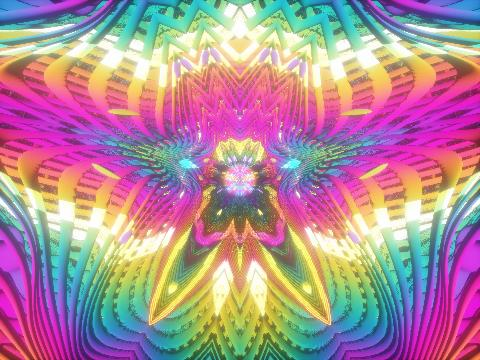

# Kaleido Tunnel — live wallpaper

A ray-marched, kaleidoscopic neon tunnel with multi-pass bloom, packaged as a
[Lively Wallpaper](https://github.com/rocksdanister/lively) web wallpaper. It is
a single self-contained WebGL2 page, so it also runs in any modern browser.

## Install in Lively Wallpaper

1. Download `KaleidoTunnel.zip` from the
   [latest release](https://github.com/MK-Aziz/kaleido-tunnel-wallpaper/releases/latest).
2. In Lively, click **+ Add Wallpaper** and drag the zip in.
   (From a clone, you can drag in `index.html` instead.)
3. Right-click the wallpaper → **Customise** to change the settings below.

To just look at it, open `index.html` in Chrome or Edge.

## Settings

| Setting | What it does |
| --- | --- |
| Animation speed | 0.1× – 3× |
| Kaleidoscope symmetry | Mirror/rotate folding of the tunnel (`sym`) |
| Mega mode | Repeats space into a grid of tunnels (`megamod`) |
| Heart tiles mode | Scrolling beating-heart tiles (`iqheart`) |
| Color palette | Cycle through all 7 palettes or lock one |
| Bloom strength | Glow amount (default 0.12) |
| Render resolution | 100 / 75 / 50 / 35 % — lower uses less GPU (default 75 %) |
| Frame-rate limit | 60 / 30 fps or unlimited |

## How it works

The page runs five fragment-shader passes every frame, mirroring the original
Shadertoy layout:

| Pass | Job |
| --- | --- |
| Buffer A | Ray-marches the tunnel (150 steps) with kaleidoscopic folding |
| Buffer B | Builds a bloom "mipmap tree" from Buffer A |
| Buffer C | Horizontal Gaussian blur |
| Buffer D | Vertical Gaussian blur |
| Image | Bicubic bloom composite, tonemapping and color grading |

Differences from the Shadertoy original:

- The background noise texture is generated in code (256×256 RGBA noise)
  instead of using a Shadertoy texture.
- Palette cycling wraps from palette 7 back to 1 (the original indexed past the
  end of its array).
- The clock wraps every 35 minutes to keep float precision stable on long runs.
- Unused code (ambient occlusion, unused SDF helpers) was removed.

## Credits

- Bloom pipeline adapted from Shadertoy [lstSRS](https://www.shadertoy.com/view/lstSRS).
- SDF primitives, palette function and the heart shape by
  [Inigo Quilez](https://iquilezles.org).
- Tunnel scene adapted from a Shadertoy shader; Shadertoy content is licensed
  CC BY-NC-SA 3.0 unless its author states otherwise.
